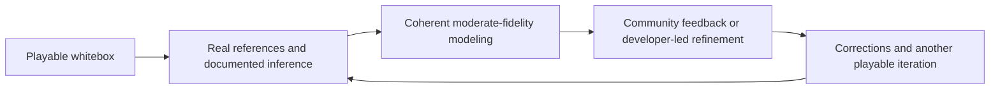

# Recommended development loop: playable early, refine together

**English** | [简体中文](zh-CN/iterative-community-modeling.md)

Establish an interactive stage early: terrain and roads, whitebox building geometry, a simple hero and usable exploration controls. Make the map something people can inspect and discuss before investing in exhaustive detail. This is the recommended starting standard for an inclusive open map project.

Use geographic measurements, depth data and archived photographs for the information they actually establish. Extract recognizable silhouettes, roof/facade patterns, material families and planting cues. Fill gaps with plausible, editable estimates, explicitly distinguishing inferred vegetation, hidden facades or decorative details from observed evidence. Moderate-fidelity first passes are welcome; they can be useful and coherent without being photorealistic or an exhaustive academic reconstruction. Keep source coordinates, footprints, roads and blocks stable when changing appearance. Use the [scene hierarchy](scene-hierarchy.md) to focus effort on the main scene and soften lower-cost surroundings.

Invite both user corrections and proactive developer improvement. Feedback can concern modeling, access assumptions, labels, controls, performance or accessibility. Attach an iteration identifier and optional location to a reproducible report; ask for only the information necessary to understand the issue. A downstream's repository owns its local feedback and development log. Reusable algorithms, interaction rules and validation lessons flow to the upstream [methodology log](../METHODOLOGY_LOG.md).

Maintain stable identities, editable source assets, provenance and uncertainty notes so corrections replace estimates deliberately. Preserve original photos and licenses, and use only assets compatible with redistribution and export. Faster modeling does not convert a restricted source into an open asset or turn an estimate into a survey. See [reference media](reference-media.md) and [progressive modeling](progressive-modeling.md).

For every iteration, inspect the affected scene in all three views, retain movement/search/navigation behavior, check source/export invariants and validate the changed interaction. Keep an inspectable local result before publishing. Record what changed, what was tested, unresolved uncertainty and actual publication status. This loop supports long-term community maintenance rather than postponing interaction until the whole map is finished.
